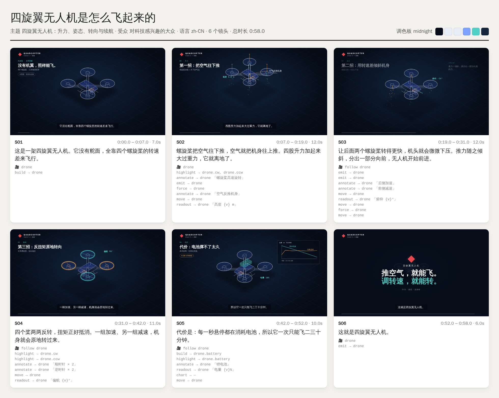

# Iso Explainer：输入关键词，生成同款等距说明动画

输入一个关键词，就能做出和参考视频同款的 **X 光线稿等距说明动画**：
- 主角物体由白色线条逐笔描出，内部组件以青色 X 光的方式显影。
- 粒子和力箭头把看不见的气流和力画出来。
- 物体自己会移动、翻转，镜头一镜到底跟着它走。
- 画面带标题区、无框标注、实时读数、内嵌图表、逐句字幕，结尾是一张金句卡。

主题、受众、语言、调色板、时长和旁白都可以自定义。默认流程是先出**故事板预览**，确认后再渲染成片。

- 参考视频拆解报告：[docs/视频拆解.md](docs/视频拆解.md)
- Skill 本体：[.claude/skills/iso-explainer/](.claude/skills/iso-explainer/SKILL.md)

## 示例
| 同款风格：「四旋翼无人机是怎么飞起来的」· midnight 调色板 · 58 秒 |
|---|
|  |
| 成片 [demo/drone-zh.mp4](demo/drone-zh.mp4) · 字幕 [srt](demo/drone-zh.srt) |

另外两个是流程图风格的示例：[RAG（中文 · paper 调色板）](demo/rag-zh.mp4)、[HTTPS（英文 · blueprint 调色板）](demo/https-en.mp4)。

## 目录
```
.claude/skills/iso-explainer/      Skill（在本仓库打开 Claude Code 时会被自动识别）
  SKILL.md                         工作流：关键词 → 主角建模 → 故事板 JSON → 预览 → (旁白) → 成片
  references/style-breakdown.md    参考视频逐段拆解与设计规范
  references/storyboard-schema.md  故事板 JSON 字段全集
  engine/                          确定性 SVG 渲染引擎（画面是时间 t 的纯函数）
  scripts/render.js                validate | preview | frame | video
  scripts/tts.py                   用 edge-tts 逐镜头生成旁白，镜头时长自动对齐语音
  scripts/analyze_reference.sh     参考视频拆解（切点、关键帧、联系表、音轨）
  examples/                        drone-zh.json（同款风格）、rag-zh.json、https-en.json
docs/                              参考视频拆解报告与关键帧
demo/                              示例的故事板预览与成片
```

## 使用
在本仓库里打开 Claude Code，直接说：
> 用 iso-explainer 做一个「火箭是怎么垂直回收着陆的」视频，面向中学生，60 秒，要旁白

也可以手动运行：
```bash
S=.claude/skills/iso-explainer
node $S/scripts/render.js preview $S/examples/drone-zh.json --out out/preview   # 故事板预览
python3 $S/scripts/tts.py $S/examples/drone-zh.json                              # 可选：生成旁白
node $S/scripts/render.js video   $S/examples/drone-zh.json --out out/drone.mp4 # 成片 + SRT
```
依赖：Node 18 或更高版本、Playwright（Chromium）、ffmpeg；需要旁白时再装 `pip install edge-tts`。

要装到其他项目，或装成个人 Skill：把 `.claude/skills/iso-explainer/` 复制到对应项目的 `.claude/skills/`，或复制到 `~/.claude/skills/`。
