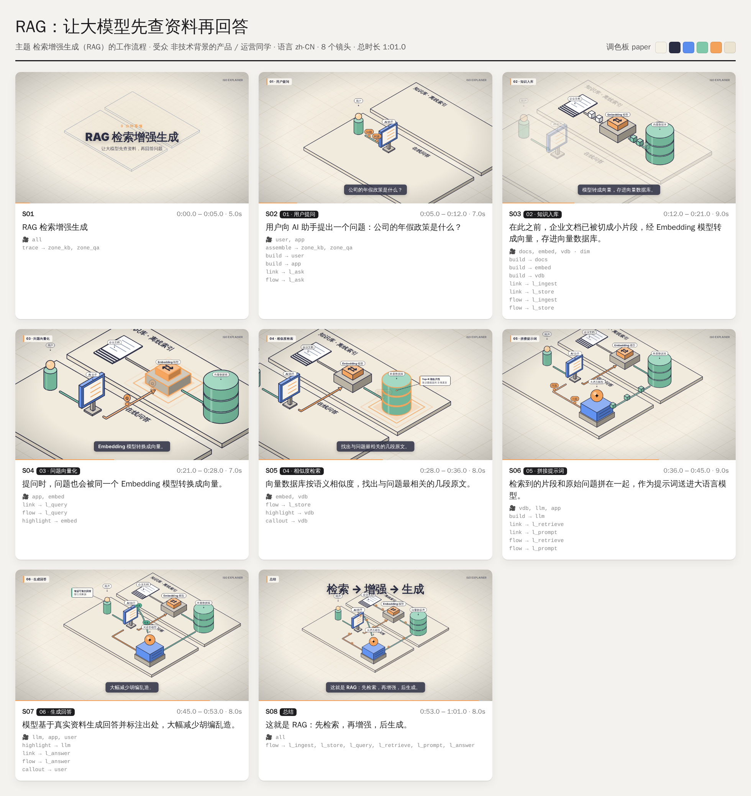
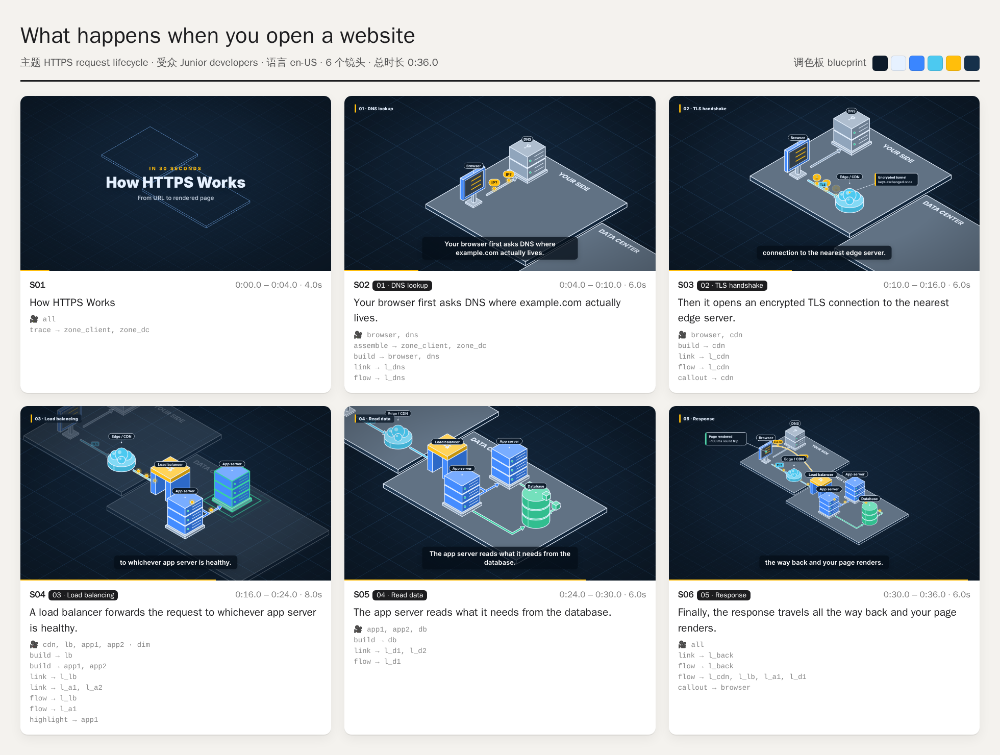

# Iso Explainer：一个关键词生成等距说明动画

输入一个关键词，生成“等距说明动画”：先用线条把部件描出来，再一块块组装成型，数据沿着管道流动，镜头在同一个空间里连续推拉，底部配同步字幕。主题、受众、语言、调色板、时长和旁白都能改。默认流程是先出**故事板预览**，确认后再渲染成片。

| 中文 · paper 调色板 · 61 s | English · blueprint · 36 s |
|---|---|
|  |  |
| [demo/rag-zh.mp4](demo/rag-zh.mp4) · [srt](demo/rag-zh.srt) | [demo/https-en.mp4](demo/https-en.mp4) · [srt](demo/https-en.srt) |

## 目录
```
.claude/skills/iso-explainer/      ← Skill 本体（放在这里，Claude Code 会自动识别）
  SKILL.md                         工作流：关键词 → 故事板 JSON → 预览 → (旁白) → 成片
  references/style-breakdown.md    视频风格拆解（设计规范 + 参考视频拆解清单）
  references/storyboard-schema.md  故事板 JSON 字段全集
  engine/                          确定性渲染引擎（SVG），画面是时间 t 的纯函数
  scripts/render.js                validate | preview | frame | video
  scripts/tts.py                   edge-tts 逐镜头旁白，镜头时长自动跟随语音
  scripts/analyze_reference.sh     拆解参考视频：切点、关键帧、联系表、音轨
  examples/                        rag-zh.json、https-en.json
demo/                              以上两个示例的故事板预览与成片
```

## 使用
在本仓库里打开 Claude Code，直接说：
> 用 iso-explainer 做一个「区块链转账是怎么完成的」视频，面向高中生，薄荷配色，45 秒，要旁白

也可以手动运行：
```bash
S=.claude/skills/iso-explainer
node $S/scripts/render.js validate $S/examples/rag-zh.json
node $S/scripts/render.js preview  $S/examples/rag-zh.json --out out/preview   # 故事板预览
python3 $S/scripts/tts.py $S/examples/rag-zh.json                              # 可选：生成旁白
node $S/scripts/render.js video    $S/examples/rag-zh.json --out out/rag.mp4   # 成片 + SRT
```
依赖：Node 18 及以上、Playwright（Chromium）、ffmpeg；需要旁白时再装 `pip install edge-tts`。

要装到其他项目，或装成个人 Skill：把 `.claude/skills/iso-explainer/` 复制到对应项目的 `.claude/skills/`，或复制到 `~/.claude/skills/`。
