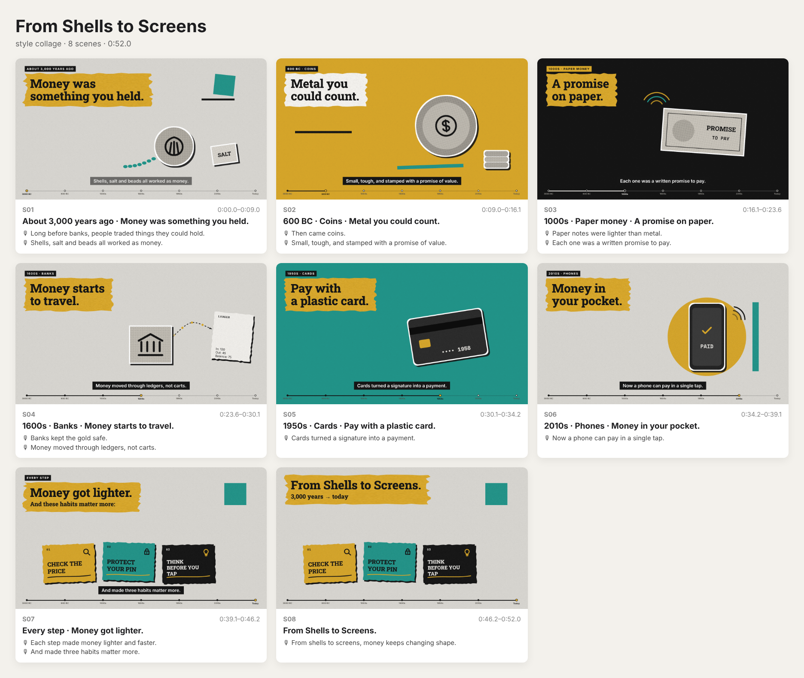
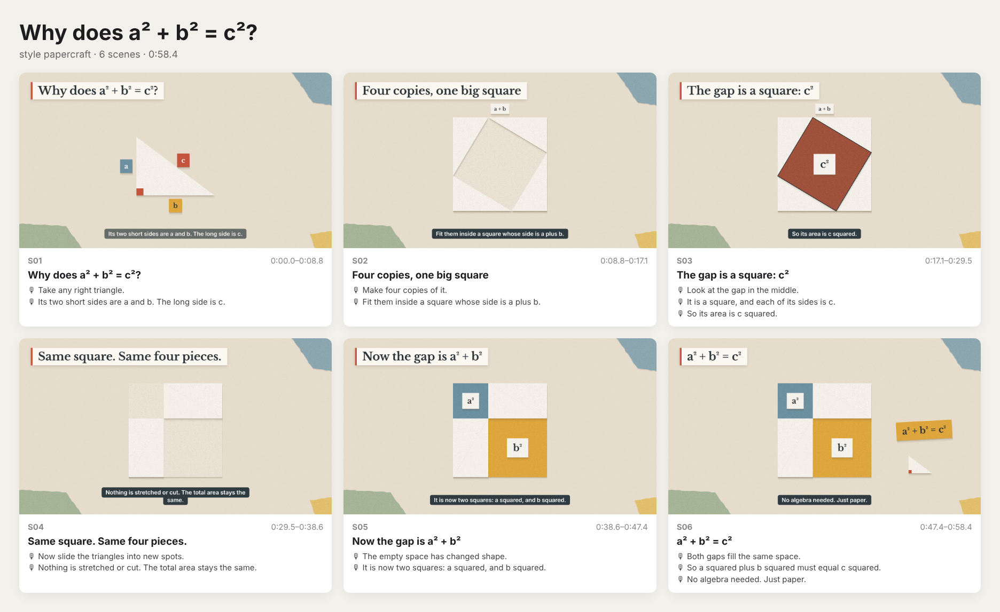
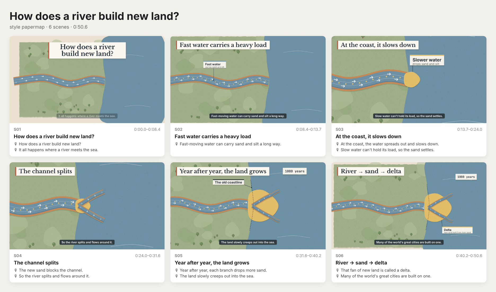

# Explainer video skills

这个仓库里有两个 Skill，在本仓库里打开 Claude Code 时会被自动识别。

| Skill | 输出 | 风格 | 参考拆解 |
|---|---|---|---|
| [`paper-explainer`](.claude/skills/paper-explainer/SKILL.md) | 一个**可直接播放的 HTML 视频**：纸艺插图、程序动画、英文配音、背景音乐、播放控件、可切换字幕（可选导出 MP4） | collage 拼贴 · papercraft 纸艺几何 · papermap 纸艺地图 · nightpaper 及自定义风格 | [docs/三个参考视频拆解.md](docs/三个参考视频拆解.md) |
| [`iso-explainer`](.claude/skills/iso-explainer/SKILL.md) | MP4 + SRT：X 光线稿等距说明动画 | midnight / draft 线稿，flat 流程图 | [docs/视频拆解.md](docs/视频拆解.md) |

## paper-explainer：输入主题，直接得到能播放的讲解短片
| collage「From Shells to Screens」 | papercraft「Why does a² + b² = c²?」 | papermap「How does a river build new land?」 |
|---|---|---|
|  |  |  |
| [money.html](.claude/skills/paper-explainer/examples/money/money.html) | [pythagoras.html](.claude/skills/paper-explainer/examples/pythagoras/pythagoras.html) | [delta.html](.claude/skills/paper-explainer/examples/delta/delta.html) |

示例要把 HTML 文件下载到本地、用浏览器打开才能播放（GitHub 页面上只显示源码）。

**配音**：默认用浏览器自带的英文语音朗读，播放器会按句等待，保证画面和配音同步；听众可以在 ⚙ 里换声音。想要统一音质，可以先用 `scripts/tts.py` 或任意 TTS 生成逐句录音，再用 `build.py` 打包进同一个 HTML。

**播放器功能**：
- 播放与进度：播放/暂停、重播、±5 秒、按章节跳转、带章节刻度的进度条
- 声音：旁白开关、音乐开关、音量（音乐会在说话时自动压低）
- 字幕与文稿：字幕开关、字号 S/M/L、倍速、全文稿（点一句即跳转）、下载 .vtt 字幕
- 其他：全屏、键盘快捷键（按 `?` 查看）、屏幕阅读器标签、减少动态效果

```bash
S=.claude/skills/paper-explainer
python3 $S/scripts/build.py $S/examples/money/story.json -o money.html     # story → 单文件 HTML
node    $S/scripts/preview.js money.html --out preview                     # 故事板预览
node    $S/scripts/export_mp4.js money.html --out money.mp4                # 可选：导出 MP4
```
依赖：Python 3；预览和导出需要 Node、Playwright（Chromium）和 ffmpeg。

## iso-explainer：X 光线稿等距说明动画
示例：「四旋翼无人机是怎么飞起来的」[demo/drone-zh.mp4](demo/drone-zh.mp4)，「飞机起飞原理」中英双语版在 [projects/takeoff/](projects/takeoff/)。

```bash
S=.claude/skills/iso-explainer
node $S/scripts/render.js preview $S/examples/drone-zh.json --out out/preview
node $S/scripts/render.js video   $S/examples/drone-zh.json --out out/drone.mp4
```

要把 Skill 装到其他项目，或装成个人 Skill：把 `.claude/skills/<name>/` 复制到对应项目的 `.claude/skills/`，或复制到 `~/.claude/skills/`。
