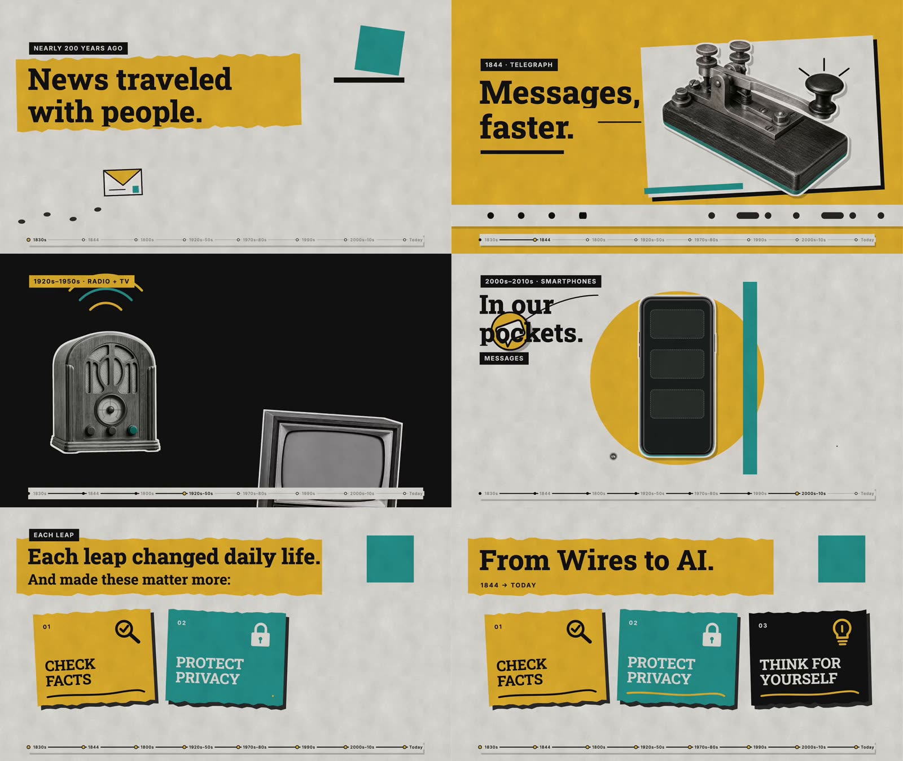
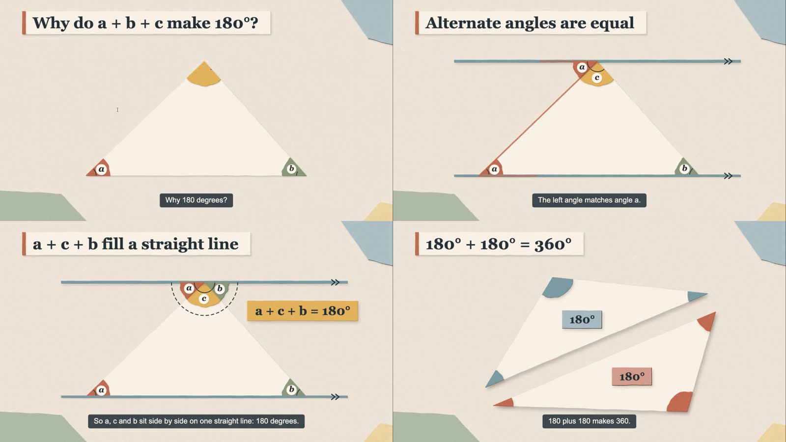
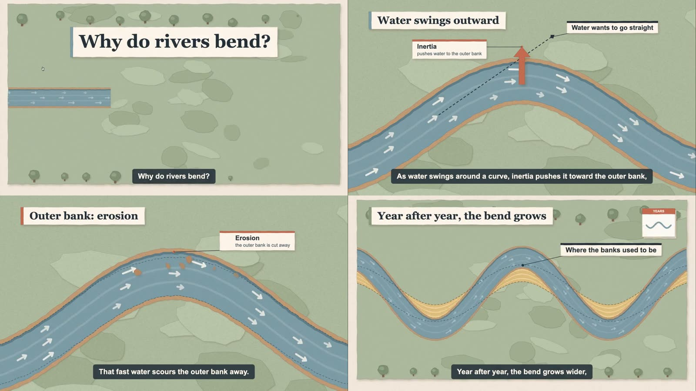

# 三个参考视频拆解（纸艺讲解动画）

三个视频都是 1280×720、30fps、带英文旁白的短片。切点检测在三个视频里都检出 0 个硬切，镜头之间靠纸张的进场、出场和过场衔接。其中 B 和 C 的画面里能看到鼠标指针，说明它们是 HTML 播放器的屏幕录像。这正是新 Skill 要输出的形态：可以直接播放的 HTML 短片。

| | A · `2d8e16…`（40.2 s） | B · `6f877d…`（27.4 s） | C · `9a27b6…`（30.2 s） |
|---|---|---|---|
| 主题 | From Wires to AI：通信史 | 为什么 a+b+c = 180°（几何证明） | Why do rivers bend?（自然过程） |
| 叙事类型 | 时间线，一个镜头讲一个年代 | 证明，一个镜头一步推导 | 过程，单一画面持续演化 |
| 风格名（Skill 内） | `collage` 拼贴杂志 | `papercraft` 纸艺几何 | `papermap` 纸艺地图 |
| 旁白断句 | 11 句，每句约 3.5 s，句间停顿 0.8–1.2 s | 约 8 句，停顿 0.3–0.4 s | 句子连贯，停顿很少 |
| 背景音乐 | 停顿处接近静音，推测没有或极轻 | 推测有轻柔垫乐 | 推测有轻柔垫乐 |
| 屏幕字幕 | 没有 | 底部深色圆角条，逐句显示 | 底部深色圆角条，逐句显示 |

---

## A · 拼贴杂志风（collage）：「From Wires to AI」
**画面语言**
- **背景**：浅灰纸张加明显的纸纹颗粒（`#d9d7d2`）。部分镜头整屏换成芥末黄 `#d8a72a`、青绿 `#22958a` 或近黑 `#141414`。
- **主体**：黑白**网点（halftone）照片剪贴**（电报机、电话、收音机、电视、电脑、手机、握笔的手），外面一圈白色贴纸描边，再加一层**硬边黑色偏移投影**。这种“剪下来贴上去”的质感是这个风格的核心。
- **标题**：粗衬线（slab serif，类似 Roboto Slab 800 字重）黑字，压在**撕边芥末黄纸条**上，逐行升起出现。上方配一个小眉标：黑底白字、大写、宽字距（“1844 · TELEGRAPH”）。
- **装饰**：青绿方块、黑色粗线、黄色半圆，加上简笔线描图标（信封、房子、地图钉），以及摩斯电码的点和划。
- **底部时间轴**：贯穿全片，1830s → Today 共 8 个节点，当前年代节点高亮，左边已走过的一段加粗。
- **结尾**：三张撕边卡片依次落下（01 CHECK FACTS / 02 PROTECT PRIVACY / 03 THINK FOR YOURSELF），每张带图标和手绘下划线；最后一个镜头的标题是「From Wires to AI.」，副标题「1844 → TODAY」。

**运动**
- 换场景时，一整张撕边纸从左往右扫过（约 0.6 s），背景颜色随之换掉。
- 物体从侧面滑入，或像纸片一样落下，带一点旋转；收音机的电波弧线、摩斯点划会逐个出现；连线用描线方式画出来。
- 节奏：每句旁白配一个画面变化。镜头 3–4 s 一个，比 B、C 快。

## B · 纸艺几何风（papercraft）：「Why do a + b + c make 180°?」
**画面语言**
- **背景**：米色纸 `#ece3d6` 加细颗粒。左下、右上、右下角各贴一块**撕边纸片**（灰蓝 `#8faab4`、鼠尾草绿 `#a9b89a`、芥末黄 `#e7c46e`），起画框作用。
- **主体**：米白纸三角形，带柔和投影。三个角是彩色**扇形楔块**（红 `#c8553d`、黄 `#e3a93b`、绿 `#7e9a73`），每个楔块上有白色圆形徽章，里面写斜体字母 a、b、c。
- **辅助线**：灰蓝色平行线，末端画「>>」平行记号；被讲到的边用红色描线强调。
- **标题卡**：左上角米白卡片，左侧有红色竖条，衬线粗体（类似 Libre Baskerville 700），每一步换一次标题。
- **公式卡**：黄色或灰蓝色小纸片，写衬线粗体的「a + c + b = 180°」。
- **字幕**：底部居中的深石板色 `#2f3b40` 圆角条，白色无衬线字。

**运动**
- 角楔块沿着平行线**滑到顶点**拼在一起，再用虚线圆弧框住“一条直线 = 180°”。
- 四边形先用虚线画出对角线，再**沿对角线拆成两张纸并错开**，接着两张 180° 标签合成一张「180° + 180° = 360°」。
- 节奏：一个推导步骤占一个标题，约 3–5 s。动作舒缓，大量使用 easeInOut。

## C · 纸艺地图风（papermap）：「Why do rivers bend?」
**画面语言**
- **背景**：鼠尾草绿纸板 `#a3b38c`，上面叠着深浅不一的有机色块（纸片地貌），四周点缀纸剪小树。开场时整块地图板放在米色桌面上，四边是撕边。
- **主体**：分层纸河。外层是橙棕色河岸 `#c98a55`，中间是蓝色水面 `#6e93a8`，水面上有浅色车道线和**白色流向箭头**沿河流动。泥沙沉积用芥末黄条纹 `#e8c26a` 表示。
- **标签卡**：白色卡片，顶部一条色条（红色 = 侵蚀，深色 = 说明），卡里是粗体标题加一行小字说明，用细引线指向画面上的点。
- **辅助**：红色粗箭头（惯性方向）、虚线（“水想走直线”）、右上角弹出的「河道横截面」小卡和「YEARS」计数卡（卡里的小图标是一条波浪线，会随时间越弯越大）。
- **标题卡和字幕**：和 B 是同一套系统（衬线标题卡 + 深色字幕条）。

**运动**
- 开场镜头从整块地图板推近；河道从左边**生长**出来，再从直线**形变**成小弯，最后变成大的蛇形河曲（同一条路径的点逐步插值）。
- 流向箭头沿河道持续流动；侵蚀颗粒从外岸剥落；沉积条带在内岸一层层加厚。
- 「Where the banks used to be」用虚线标出原来河岸的位置，形成前后对比。

---

## 共同规律（写进 Skill 的设计规范）
1. **一句旁白对应一个画面动作。** 所有动画都锚定在旁白句子（cue）的开始或结束时刻，所以换任何配音，画面都能保持同步。
2. **纸张质感三件套**：颗粒纸背景、撕边、投影（B 和 C 用柔和投影，A 用硬边偏移投影）。
3. **信息层级**：小眉标 → 大标题 → 画面主体 → 标签卡 → 底部字幕。
4. **配色**：每种风格只有一个底色，加 3–4 个功能色；强调色一次只用在当前讲到的东西上。
5. **节奏**：时间线叙事 3–4 s 一个镜头，推导和过程叙事 4–6 s 一步。全片 25–45 s。
6. **结尾**：一句总结标题，加 2–3 张要点卡，或者展示“前后对比”的完成状态。

## 映射到 Skill（`.claude/skills/paper-explainer`）
| 观察到的特征 | 实现 |
|---|---|
| 三种画面系统 | `style`: `collage` / `papercraft` / `papermap`，可通过 `palette`、`titleVariant`、`bg` 组合出新风格 |
| 网点剪贴物体 | `sticker`（白描边 + 硬投影）+ `halftone` 网点填充，内容来自内置图标库或用户提供的图片 |
| 撕边纸、纸片、投影 | 所有纸张元素都有 `torn`、`shadow` 属性，背景自带颗粒纹理 |
| 角楔块、平行线、公式卡 | `angle`、`arrow`（`head: "chevrons"`）、`tag` |
| 纸河生长和形变、流向箭头 | `band`（关键帧 `points` 形变，`grow` 生长动画）+ `flow` |
| 标签卡、计数卡、横截面卡 | `label`、`counter`、`card` / `chart` |
| 底部年代时间轴 | `meta.timeline` + 镜头级 `timeline` 索引 |
| 撕纸过场 | 镜头级 `transition: "tear"`，另有 `fade` / `slide` / `cut` |
| 播放器 | 播放/暂停、重播、可拖动进度条（带章节刻度）、倍速、字幕开关和字号、旁白和音乐音量、全屏、全文稿、键盘快捷键、减少动态效果、屏幕阅读器标签 |
