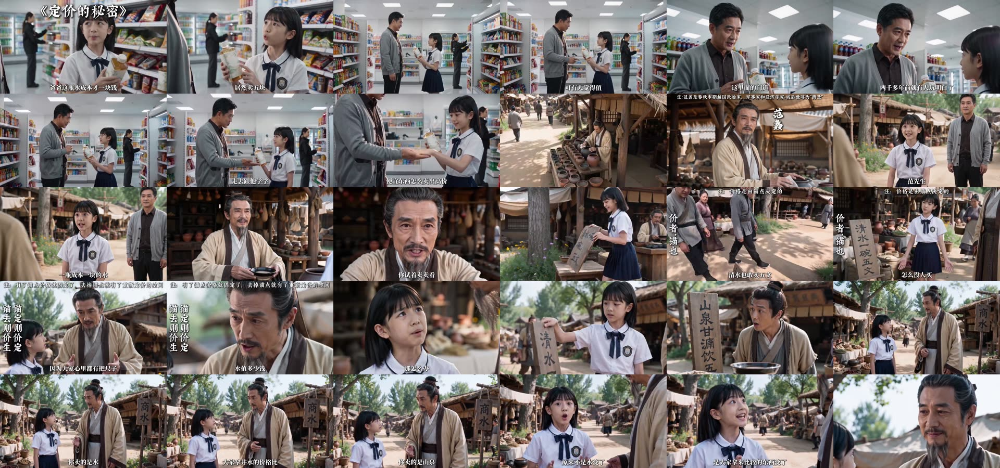
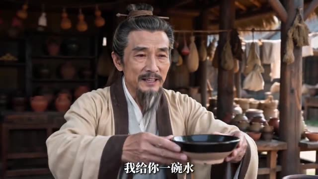
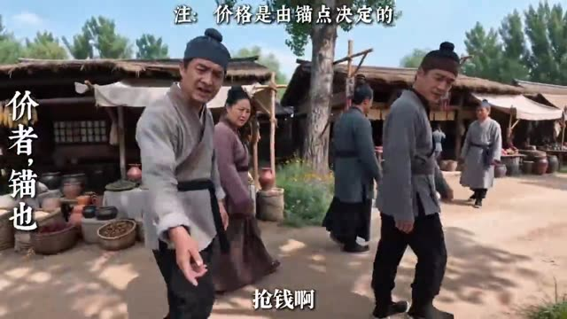
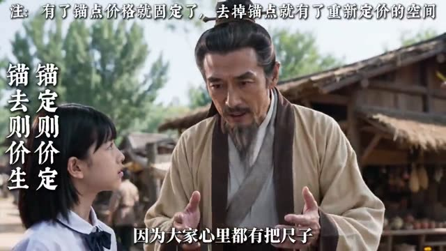
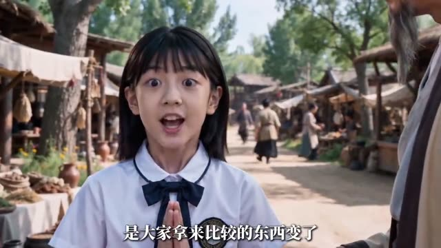
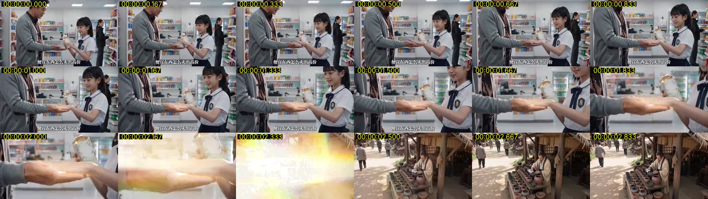

# 参考视频拆解：《定价的秘密》古今拜师短剧

**源文件**：仓库根目录 `7fe47fb3845d1dab62e826dbb6586efc59ad966b2319609b650e2dd994206d27.mp4`。59.3 秒，1280×720，30fps。
**方法**：先每秒抽 1 帧做联系表，再在关键时刻抽全分辨率帧，白闪段按每秒 6 帧逐帧看。台词以画面硬字幕为准逐条誊录。

## 结论速览
1. **结构**：现代冲突 → 白闪穿越 → 拜见古人 → 古人出题 → 女儿按常识失败 → 原理上屏 → 一招改道具 → 反应翻转 → 对仗点破 → 女儿领悟。参考片只演完**一招**（改名字），一招约 40 秒。
2. **古人不讲课**：范蠡全片只说约 10 句短话，每句不超过 15 个字。原理由顶部“注：”条和左侧竖排对仗口诀承担。
3. **道具是论证本身**：同一块木牌，“清水一碗，五文”翻过来变成“山泉甘洌饮五文”。观众看到的是牌子变了，路人的反应也跟着变了。
4. **白闪**：两手相触 → 掌心金光 → 推近 → 过曝到白，带彩虹漏光（约 0.5 秒）→ 硬切到古代大全景。
5. **冷暖对比**：现代用冷白荧光灯，古代用暖金阳光；父女穿着现代服装进入古代，一眼就能认出穿越者。
6. **字幕版式**：底部单句白字黑边、无标点；顶部“注：”旁注；左侧书法竖排口诀（自右向左）；人名竖排在人物旁；开头顶部《片名》。

## 关键帧
| | |
|---|---|
|  0.5s 开场发难，片名叠在顶部 |  7.5s 父亲抛钩子 |
|  17.9s 白闪：掌心金光 |  20.5s 古人登场：注释加竖排人名 |
|  28s 出题：“我给你一碗水” |  34s 失败：路人嗤笑，“价者，锚也” |
|  37s 原理：注释条加对仗口诀 |  43s 改道具：牌子翻面 |
|  51s 对仗点破 |  56.5s 领悟：双手合十 |

白闪逐帧（每格 1/6 秒）：

## 从拆解到 Skill
完整的逐段时间线、版式数值和单招八拍，见 [`references/reference-breakdown.md`](../.claude/skills/ancient-mentor-drama/references/reference-breakdown.md)。

| 参考片特征 | Skill 中的实现 |
|---|---|
| 一招的八拍节拍 | `moves` 加 `move1..3` 段落；`check` 检查每招都有道具改动、路人反应、注释、口诀和领悟句 |
| 只有一招，约 1 分钟 | 扩成三招（改名字、留缺点、换叫法），再加回现代对照，约 3 分钟 |
| 木牌翻面 | 镜头的 `prop_state`、`prop_change`，提示词里写死牌上的字 |
| 白闪转场 | `transition: "whiteflash"`，渲染为淡到白再从白淡出；全片恰好 2 次 |
| 台词字幕、注释、竖排、人名、片名 | `episode.py subs` 生成 ASS：Sub、Note、Vert、Name、Title 样式 |
| 人物一致 | `cast.*.look` 拼进每个镜头的提示词，`ref` 是定妆照 |
| 当代对照（参考片未演） | `contrast` 段的 3 个 `tag` 镜头，逐一回指三招 |
