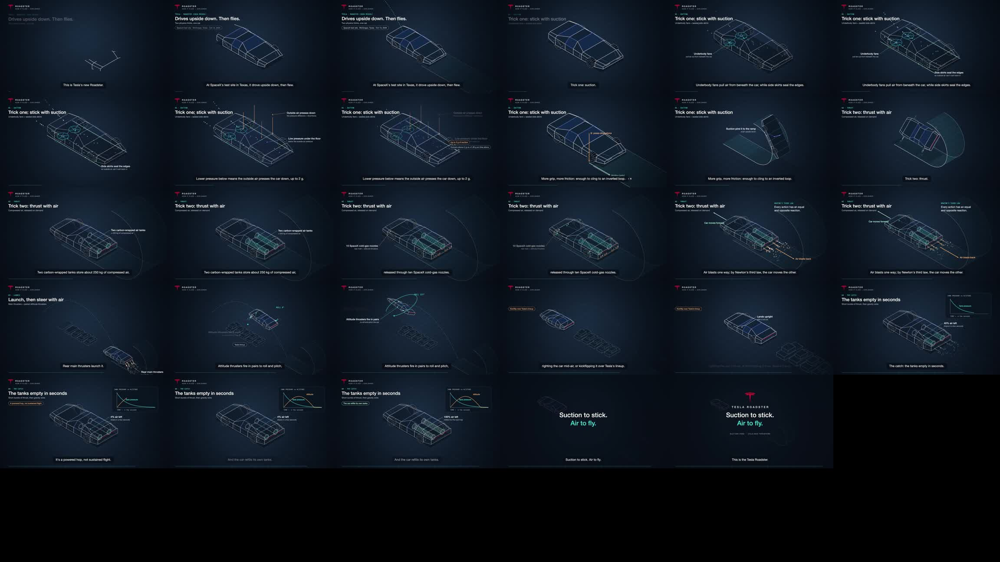
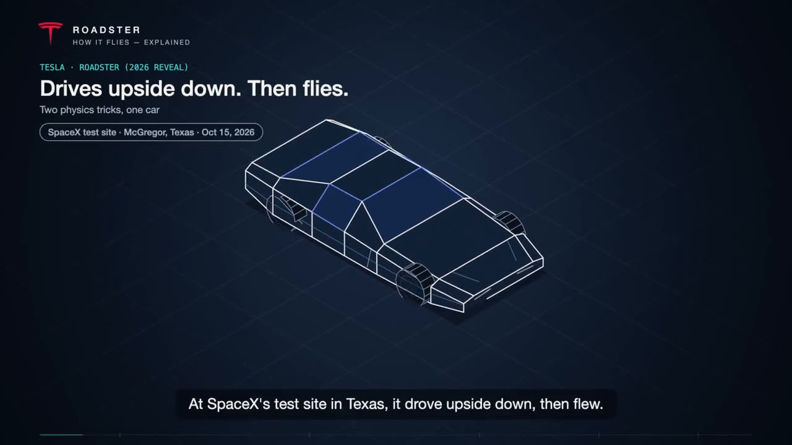
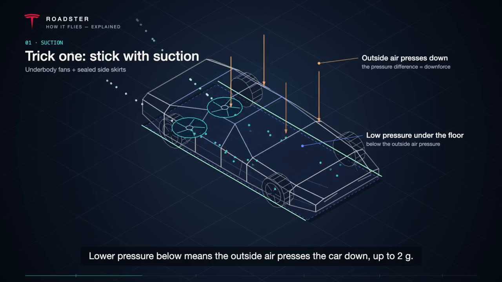
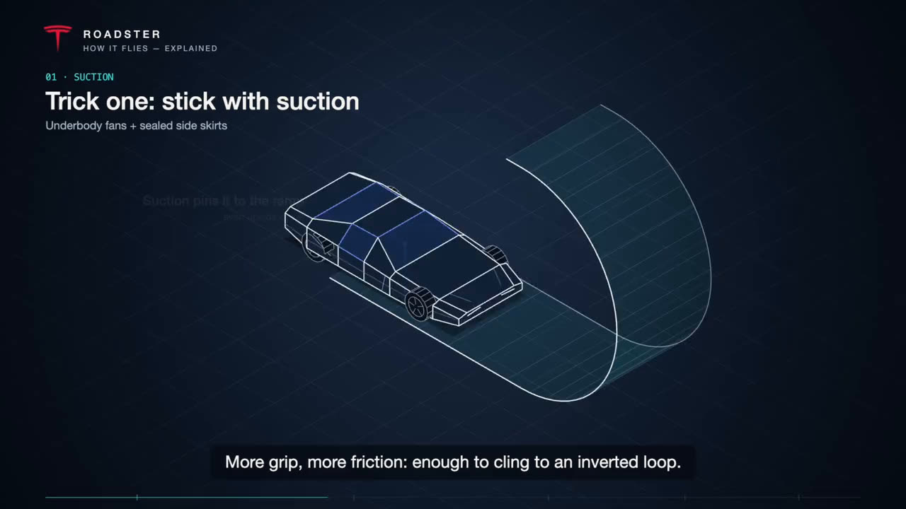
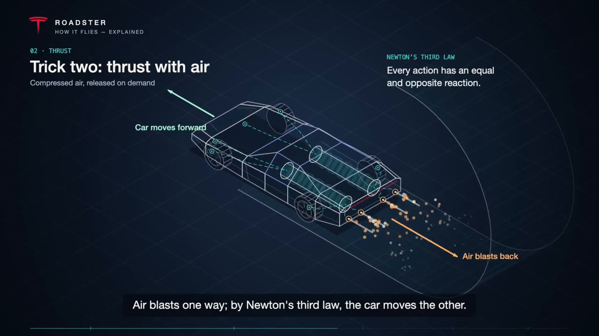
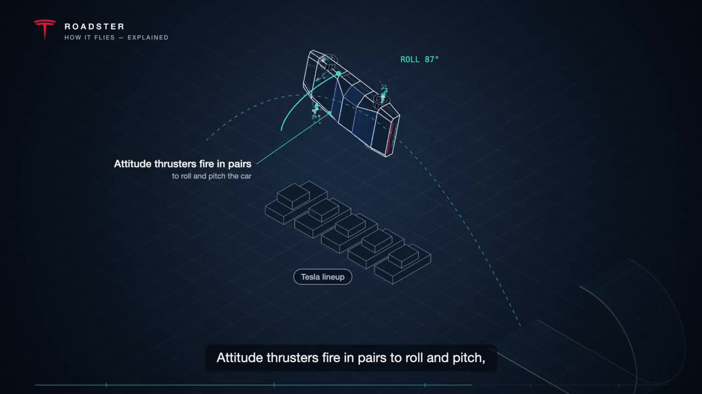
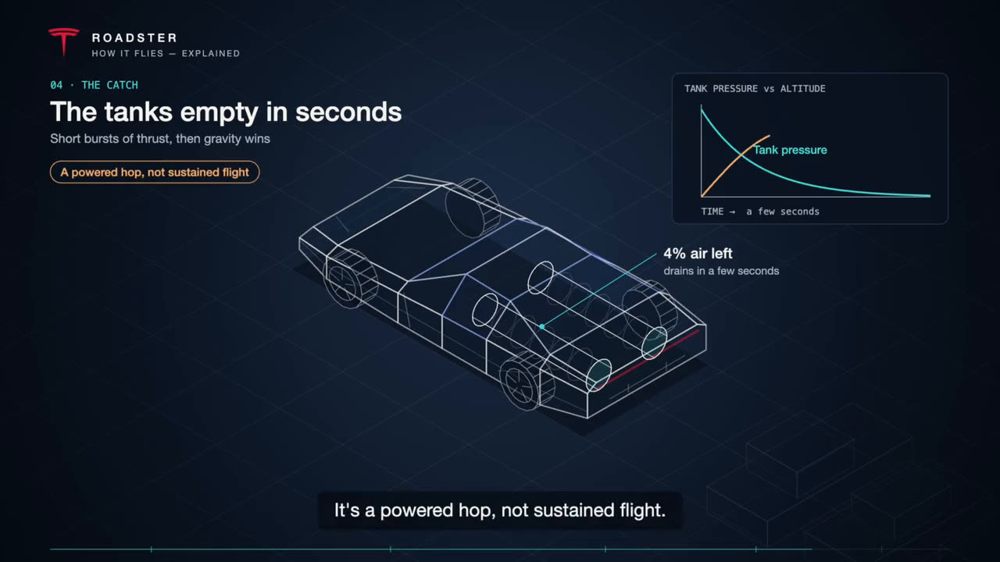
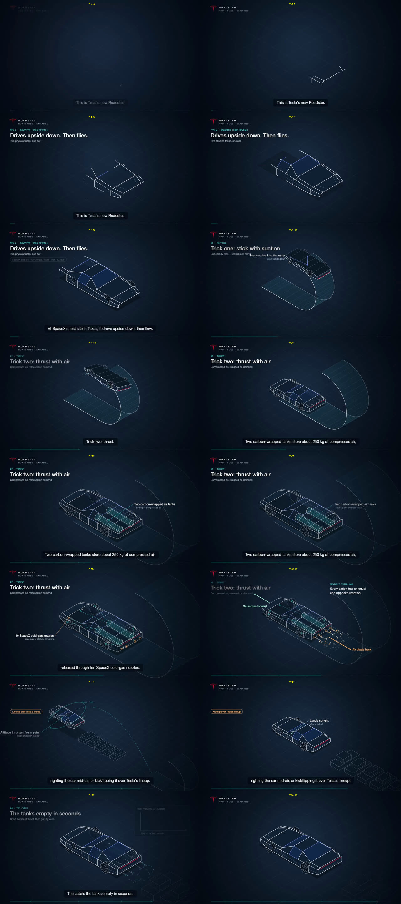

# 参考视频拆解报告

**源文件**：仓库根目录的 `432b7027…71c.mp4`。《ROADSTER — HOW IT FLIES, EXPLAINED》，57.9 秒，1280×720，30fps，H.264 编码，AAC 立体声旁白。
**拆解方法**：先用 `analyze_reference.sh` 做切点检测，并每 2 秒抽一帧；再在关键时刻抽全分辨率帧；最后用静音检测找出旁白的断句位置。逐帧对照后，量化写入下面的规范。

## 结论速览
1. **一镜到底，没有硬切。** 场景检测阈值设为 0.2 时检出 0 个切点。段落之间靠镜头推拉、跟随，以及主体自己运动来衔接。
2. **全片只有一个主角物体**：一辆车，用 X 光线稿画法。白色细线勾轮廓，面是半透明深蓝，车窗和顶盖填蓝色玻璃色。
3. **线条描摹不是淡入，而是一条一条“长”出来。** 0.5–2.8 秒之间，车身从几根线逐步画完整，然后玻璃面板再填色。
4. **内部组件到讲它的那一章才显影。** 风扇、储气罐、喷嘴依次以青色线条加斜线填充出现，就是组件组装。
5. **看不见的东西都被画出来了**：青色粒子表示被抽走的空气，橙色粒子表示喷出的气流，橙色箭头表示下压力，虚线抛物线表示飞行轨迹。
6. **主体自己会动**：开上环形坡道倒挂、沿抛物线起飞、翻滚 360°（读数 `ROLL 87°` 实时滚动）、最后正立落地。
7. **固定的信息版式**：左上依次是品牌区、章节号（等宽青色字）、大标题、副标题、胶囊标签；右上放事实框或内嵌曲线图；底部是逐句字幕，以及带章节刻度的进度条。
8. **叙事模板**：钩子 → 第一招 → 第二招 → 组合应用 → 代价 → 对仗金句结尾卡。

## 关键帧
| | |
|---|---|
|  开场：主体描完，标题区和胶囊标签出现 |  01 吸附：X 光显出风扇、青色气流粒子、橙色下压力箭头、无框标注 |
|  环形坡道线描出来，主体开上去 |  02 推力：储气罐用斜线填充、橙色喷流、右上事实框 |
|  03 发射：抛物线轨迹加 ROLL 读数，主体在翻滚 |  04 代价：内嵌曲线图、橙色胶囊、百分比读数 |
|  结尾卡：标志、宽字距品牌名、白青两行金句、关键词脚注 |  时间序列采样 |

## 逐段时间线、版式数值、配色、动作语法
完整内容见 Skill 内的 [`references/style-breakdown.md`](../.claude/skills/iso-explainer/references/style-breakdown.md)。它同时就是生成新视频时遵循的设计规范。

## 从拆解到 Skill 的映射
| 参考视频特征 | Skill 中的实现 |
|---|---|
| X 光线稿主体 | `object` 节点：`extrude` 侧剖面、`cyl`/`wheel`/`fan`、`box`、`line`，在 `wire` 风格下渲染 |
| 线条逐条生长 | `build`/`trace`：所有边按顺序依次描出，面延后淡入 |
| 分章显影内部组件 | 零件 `group` 加 `"<id>.<group>"` 动作，`style: "hatch"` |
| 气流、喷流 | `stream`、`emit` 粒子 |
| 力 | `force` 箭头 |
| 主体运动、翻滚 | `move`（`to`/`by`/`rot`/`arc`），`camera.follow` |
| 标注、读数、图表、事实框 | `annotate`、`readout`、`chart`、`fact` |
| 品牌区、标题区、胶囊标签 | `meta.brand`、镜头级 `header` |
| 逐句字幕、章节刻度进度条 | 字幕自动按句切分，进度条刻度自动生成 |
| 金句结尾卡 | `overlay`（`mark`/`title`/`title2`/`footer`/`backdrop`） |
| 深蓝背景加青、橙双强调色 | 调色板 `midnight`，浅色版为 `draft` |
